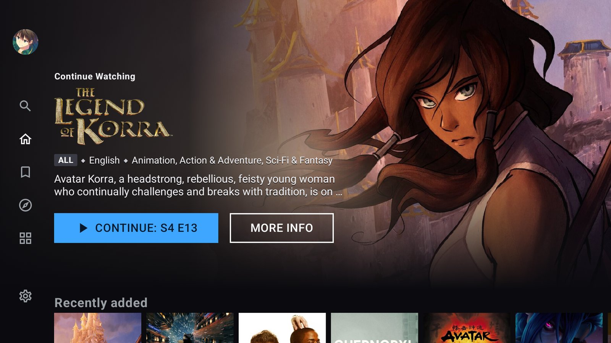

# Roxy TV

A self-hosted media server with its own Android TV, phone and web apps, built so styled
subtitles play the way they were made, on every screen, without the server transcoding.



*Roxy TV on a TCL Google TV.*

## Why

Many foreign shows and films come with ASS/SSA subtitles, which do far more than put text
at the bottom of the screen:

- translate a shop sign, a text message or a letter right where it appears
- give each speaker their own colour, font and position
- run karaoke over a theme song, lighting up each syllable in time with the music

On most TVs and phones, Plex and Jellyfin can't draw these. The server does it instead:
it transcodes the whole video live and burns the subtitles into the picture, every time
you press play. That costs CPU or GPU, picture quality, seeking speed, and buffering when
the server can't keep up.

Roxy puts the subtitle renderer (libass) in every app: libmpv on Android phones and
Android TV, libass in WebAssembly in the browser, using the fonts packed inside the video
file. The original file plays untouched, and the server never transcodes for subtitles.

## What you get

- **Android TV**: built for the remote. Continue Watching up front, skip intro and outro,
  next episode, scrubbing with preview thumbnails, Dolby and DTS passed to the soundbar,
  sign-in by scanning a QR code with your phone.
- **Phone**: video plays on the show's page, turn for full screen, picture-in-picture,
  offline downloads whose progress syncs when you're back online.
- **Web**: open the server's address in Chrome or Edge, nothing to install.
- **Everywhere**: a profile for each person in the house, progress that follows you between
  screens, audio and subtitle language preferences per profile, a quality option for slow
  connections (GPU transcoding on NVIDIA, Intel or AMD), and a Discover tab that can send
  requests to Sonarr and Radarr.

The full list is in [docs/FEATURES.md](docs/FEATURES.md).

## Install

### Server (Docker)

You need a Linux machine with Docker. A GPU is optional and only used for the lower
quality options.

```
git clone https://github.com/drewfoos/roxy-tv.git
cd roxy-tv/deploy
```

Open `docker-compose.yml` and, under the `roxy` service, point the media volume at your
library and list its folders in `ROXY_MEDIA_ROOTS`. Then build and start it:

```
docker compose up -d --build roxy                                                      # AMD / Intel GPU, or none
docker compose -f docker-compose.yml -f docker-compose.nvidia.yml up -d --build roxy   # NVIDIA
```

Open `http://<server address>:8096` from a computer on the same network. The setup wizard
creates your admin account, asks for a free [TMDB](https://www.themoviedb.org/settings/api)
API key for posters and descriptions, and lets you pick the media folders.

Library folders follow the usual layout (`Show Name (Year)/Season 01/...`,
`Movie Name (Year)/...`), the same one Sonarr, Radarr, Plex and Jellyfin use.

### Apps

- **Web**: nothing to install; open the server's address in Chrome or Edge.
- **Android phone and Android TV**: one APK for both. For now it is built from source, see
  [docs/DEVELOPING.md](docs/DEVELOPING.md). Once installed, the app finds the server on
  your network.

## Documentation

- [docs/FEATURES.md](docs/FEATURES.md): everything the server and apps do.
- [docs/DEVELOPING.md](docs/DEVELOPING.md): building from source, the repository layout,
  every setting.
- [docs/ARCHITECTURE.md](docs/ARCHITECTURE.md), [docs/ROADMAP.md](docs/ROADMAP.md),
  [docs/adr/](docs/adr/): design and decisions.
- [docs/api/native.md](docs/api/native.md): the `/v1` API the apps speak.
- [docs/research/](docs/research/): how Plex, Jellyfin and other players handle subtitles,
  with sources.

## License

[GPL-3.0](LICENSE).
